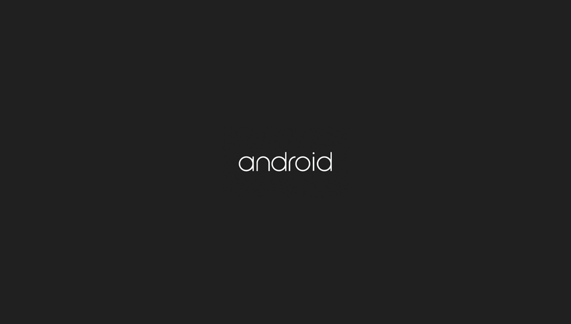

<h1 align="center">
  <br>
  Zenonia 4 · PS Vita Port (Turbo Edition)
</h1>

<p align="center">
  <b>Native port of Zenonia 4: Return of the Legend (Gamevil) for PlayStation Vita and PlayStation TV.</b>
</p>

<p align="center">
  
  
  
  
  
  
</p>

<p align="center">
  <a href="#-description">Description</a> •
  <a href="#-features">Features</a> •
  <a href="#-controls">Controls</a> •
  <a href="#-installation">Installation</a> •
  <a href="#-known-issues">Known Issues</a> •
  <a href="#-building-from-source">Build</a> •
  <a href="#-credits">Credits</a>
</p>

---

## 📖 Description

**ZENONIA® 4: Return of the Legend** is an action RPG developed and published by **Gamevil**. This repository contains an unofficial loader for the **ARMv7 Android release of Zenonia 4**, based on the Android SO Loader framework by TheFloW. The loader provides a tailored, minimalistic Android runtime environment (via FalsoJNI and vitaGL) to execute the original `libgameDSO.so` directly on the PlayStation Vita.

Unlike Zenonia 2 and 3 (which rendered at lower resolutions like 400×240 or 480×320), **Zenonia 4 runs internally in full 960×544 HD resolution**, quadrupling the pixel workload and software rasterization requirements on the Vita's hardware.

### 🔬 Technical reality and bottlenecks

**1. The CPU software rasterization bottleneck**
- **Engine architecture**: Zenonia 4's engine (Gamevil Nexus2 / "Clet") is primarily a **CPU software rasterizer**.
- **The frame loop**: on every frame, the ARM Cortex-A9 CPU executes hundreds of proprietary RLE sprite decompression calls (`PutCompressImg`), writing 16-bit RGB565 pixels directly into a 960×544 software framebuffer in RAM (~1,044,480 bytes).
- **The memory bus limit**: once software blitting finishes, the CPU uploads the entire 1.04 MB buffer to the GPU via `glTexSubImage2D` before calling `vglSwapBuffers()`.
- **The performance ceiling**: on the PS Vita's Cortex-A9 CPU running at 444 MHz, single-threaded software rasterization of 960×544 sprites maxes out at **~10–13 FPS** during combat.

**2. The GPU offload dilemma (why GPU quads are not the default)**

During development (Fases 47–81, 108–113), an ambitious GPU Offload architecture (`GPU_QUADS` / `GPU_ATLAS`) was created to intercept `PutCompressImg` and offload sprite decoding into textured hardware quads via vitaGL. Extensive testing on physical Vita hardware revealed critical driver and architecture limitations:

| Problem Encountered | Technical Root Cause | Impact on Hardware |
| :--- | :--- | :--- |
| **💥 Hard console freezes / bricks** | Dense combat scenes emit **12,000 to 16,000+ quads per frame**. Without VSync throttling, vitaGL's GPU ring buffer overflows. | **Requires 30s power button hard reset** (no `.psp2dmp` crash log generated). |
| **🌀 Stage transition desyncs** | Dynamic texture cache allocation during map/stage transitions caused vitaGL context stalls and black screens. | Game freezes when walking through transition portals. |
| **👻 Missing / scrambled sprites** | Color-key transparency (0x0001) and texture re-binding conflicts between the base framebuffer and atlas textures. | Sprites occasionally rendered with black rectangles or vanished entirely. |

> [!IMPORTANT]
> **Conclusion**: GPU sprite offload is inherently unstable for this engine on VitaGL. The safe, reliable path forward is **100% authentic CPU software rasterization combined with multi-tier frame skip**.

**3. The solution: multi-tier frame skip and turbo architecture**

To overcome the CPU bottleneck while preserving 100% original graphics and rock-solid stability:
1. **Intelligent frame pacing**: on skipped frames, `handleCletEvent` (touch/pad inputs), physics, enemy AI, damage calculations, and quest timers advance at full **60 Hz** in only **~1.5 ms**, while CPU RLE sprite blits and 1.04 MB texture uploads are bypassed.
2. **Real-time speed multipliers**: players can toggle between **1.0x (Normal)**, **1.5x**, **2.0x (Default)**, **2.5x**, and **3.0x (Max)** on the fly via `R-Trigger + SELECT`.
3. **FastClear bypass**: omits redundant full-frame 1.04 MB black clears on skipped frames, saving CPU memory bandwidth.
4. **Off-screen UI buffer preservation**: ensures all off-screen text caches (`p9 != 0`) are executed 100% of the time, fixing missing labels on inventory/pause popups (*Destroy*, *Repair*, *Equip*).
5. **No-logs turbo release**: completely compiles out debug logging (`ENABLE_LOGGING=OFF`), removing all SD card / SD2Vita write latency and format string overhead during gameplay.

---

## 🎮 Status & Playability

**Status: Playable** (VPK `01.00`; latest release v1.2.0 in [`RELEASE_NOTES.md`](RELEASE_NOTES.md))

The game runs on physical PS Vita hardware with the original graphics and game speed. Combat runs at about 15–20 FPS with frame skip AUTO (v1.2.0), and the heaviest scenes can still dip to ~12 FPS (see [Known Issues](#-known-issues)).

- [x] **Original game speed** (v1.1.0): the game runs at its original 21 FPS in menus and 23 FPS in gameplay, as the Android game requests. Movement speed stays constant even in heavy fights.
- [x] **Frame skip AUTO** (default, v1.1.0): skips drawing a frame only when the game falls behind. OFF draws every frame, but the game slows down in heavy scenes.
- [x] **Optional 30 FPS mode** (v1.1.0, Zenonia 2/3 style): the whole game runs about 1.3x faster.
- [x] **PS Vita options menu** (START + SELECT, v1.1.0), ported from the Zenonia 3 port: remap every action, change frame skip, FPS and on-screen buttons. The game pauses while it is open.
- [x] **Multi-core sprite rendering** (v1.2.0): large sprites are split into horizontal bands and drawn on cores 0, 2 and 1 at the same time, with the same pixels as the original renderer. Combat goes from 10–12 FPS to 15–20 FPS with AUTO frame skip.
- [x] **Faster framebuffer upload** (v1.1.0): down from ~17 ms to ~1.6 ms per frame (3-texture ring instead of vitaGL's copy-on-write).
- [x] **Input** (v1.1.0): left stick moves; input no longer lags or gets stuck (all queued button events are handled every frame).

### 📋 Changelog

#### v1.2.0: multi-core sprite rendering

- **🧵 Uses all 3 CPU cores for sprite drawing.** Large sprites are split into horizontal bands and drawn on cores 0, 2 and 1 at the same time, producing exactly the same pixels as the original renderer. The game now shows **15–20 FPS in combat (was 10–12)** with AUTO frame skip, and ~17 FPS with frame skip OFF. Game speed stays at the original 23. Audio keeps priority on its core.
- **⚙️ Frame skip in the options menu.** START + SELECT now has Frame skip, Frame rate and On-screen buttons, each with its shortcut shown. The frame skip choice is saved too.
- **Known limitations**: the heaviest scenes can still dip to ~12 FPS. All three CPU cores show high usage while playing, which is expected: the helper threads wait for sprites without sleeping, to react instantly. They sleep when the game isn't drawing. START + SELECT doesn't exit the game; use the PS button.
- **Installing v1.2.0**: install `zenonia_4_pace_nologs.vpk` with VitaShell. It updates v1.1.0 in place; your saves and settings are kept.

#### v1.1.0: original game speed, options menu and remapping

- **⏱️ Correct game speed.** Zenonia 4 was designed to run at **21 FPS in menus and 23 FPS in gameplay** (the Android game asks for it itself). Earlier builds ignored that, so menus ran too fast, combat ran in slow motion and the fixed frame-skip patterns made characters stutter while walking. The game now always runs at its original speed.
- **🎞️ AUTO frame skip (default).** It skips drawing a frame only when the game falls behind, so movement speed stays constant even in heavy fights. OFF draws every frame, but the game slows down in heavy scenes.
- **⚡ Optional 30 FPS mode** (Zenonia 2/3 style): the whole game runs about 1.3x faster.
- **🎮 PS Vita options menu (START + SELECT)**, ported from the Zenonia 3 port: remap every action, change FPS, show or hide the on-screen buttons. The game pauses while it's open.
- **👆 Hide the on-screen buttons (R + L).** They still respond to touch, and the game runs noticeably faster with them hidden.
- **🕹️ Left stick moves**, and input no longer lags or gets stuck (all queued button events are now handled every frame).
- **🖼️ Faster framebuffer upload.** Down from ~17 ms to ~1.6 ms per frame (3-texture ring instead of vitaGL's copy-on-write).

### 📊 Tested build variants and benchmarks

All optimization variants tested and documented in `port_progress.md`:

| Build Flag / Variant | Description | Observed FPS | Stability & Known Issues |
| :--- | :--- | :---: | :--- |
| **`--turbo-nologs`** *(Official)* | Multi-tier FrameSkip + FastClear Bypass + NEON Libc + Audio RAM cache + No Logs. | **20 – 30+ FPS** | **100% Stable**. Authentic graphics, zero crashes, zero stage-transition hangs. |
| **`--turbo-opt`** | Same as Turbo, but with active file logging to `ux0:data/zenonia-4/logs/`. | 18 – 25 FPS | Stable. Slight SD card I/O latency when logging frequent sound events. |
| **`--cpu-max-opt` / `--frameskip-test`** | Baseline FrameSkip on gameplay frames. | 15 – 22 FPS | Stable. Text in popups previously missing (fixed in Phase 123). |
| **`--skip-blit-test`** | Theoretical CPU FPS ceiling (PutCompressImg is a no-op; sprites not drawn). | ~24 – 28 FPS | Diagnostic only. Proves that CPU logic takes ~38 ms per frame without blits. |
| **`--fastclear-neon-test`** | Re-implemented `FastClearNonClipping` in ARM NEON. | ~11 – 13 FPS | Stable. Modest ~0.5 ms gain per frame. |
| **`--primitives-opt-test`** | NEON FastClear + NEON `memcpy`/`memset`. | ~12 – 14 FPS | Stable. Baseline memory copy optimization. |
| **`--downsample-test`** | Reduced internal rendering resolution (2/3 or 3/4) + GPU bilinear upscale. | ~18 – 22 FPS | **Flawed**. Alters the game's camera zoom/FOV because engine couples FOV with resolution. |
| **`--sprite-decode-test`** | Re-implemented RLE sprite decoding in portable C. | ~10 – 11 FPS | **Glitches**. Distorted sprites and broken alpha blending on complex equipment. |
| **`--sprite-decode-cache-test`** | CPU RAM cache for decoded sprite surfaces. | ~10 – 12 FPS | Ineffective. High cache miss rate during continuous combat animations. |
| **`--gpu-quads-test`** | Intercepts `PutCompressImg` and batches textured quads via vitaGL. | ~18 – 24 FPS | **Unstable**. Can crash in heavy combat and during stage transitions. |
| **`--gpu-quads-novsync-test`** | GPU Quads with VSync disabled (`DISABLE_VSYNC=ON`). | ~25 – 30 FPS | **DANGEROUS**. Overflows GPU command buffer; causes **hard system freeze** requiring hard reset. |

---

## ✨ Features

| Feature | Status | Notes |
| :--- | :---: | :--- |
| Boots to gameplay | ✅ | Runs from boot into gameplay on console |
| Graphics / renderer | ✅ | Original CPU software rasterization at 960×544 through vitaGL; "authentic graphics" per the turbo build |
| Audio & music | 🧪 | Audio RAM cache and audio priority on core 0; not explicitly confirmed on console in this README |
| Video / cutscenes | 🧪 | Not documented |
| Physical buttons | ✅ | Controls table below; button input no longer lags (v1.1.0) |
| Analog sticks / camera | ✅ | Left stick moves the character |
| Touch screen | ✅ | Full native touch controls and UI navigation |
| Button remapping / port menu | ✅ | START + SELECT menu: remap every action, frame skip, FPS, on-screen buttons, text language |
| Save data | ✅ | Quick save with L-Trigger; saves are kept across updates |
| Native trophies | ➖ | Not documented |
| Languages | 🧪 | English (default), with ES / PT translation packs; not explicitly confirmed on console |
| Performance | 🟡 | 15–20 FPS in combat (v1.2.0), dips to ~12 FPS in the heaviest scenes; original game speed 23 FPS |
| Online / IAP / ads | ➖ | Not documented |
| PS TV | 🧪 | Not documented |

Legend: `✅ Working (verified on console) · 🧪 Implemented, not yet verified on console · 🟡 Partial · ❌ Not working · ➖ Not applicable · ❔ Not documented yet`

---

## 🎯 Controls

| Button / Input | In-Game Action |
| :--- | :--- |
| **D-Pad / Left Stick** | Move character / Navigate menus |
| **Cross (✕)** | Attack / Confirm / Interact |
| **Circle (◯)** | Back / Cancel / Menu |
| **Triangle (△)** | Skip dialogue / Cutscene |
| **Square (□)** | Open World Map |
| **L-Trigger** | Quick Save Game |
| **START + SELECT** | PS Vita options menu: button remapping, frame skip, FPS, on-screen buttons, text language (game pauses) |
| **R + SELECT** | Frame skip: **AUTO** (default) / OFF |
| **L + SELECT** | FPS: **23** (default, original game speed) / 30 (faster, Zenonia 2/3 style) |
| **R + L** | Show / hide the on-screen buttons (default: shown; hidden buttons still respond to touch) |
| **Front Touchscreen** | Full native touch controls & UI navigation |

Default layout (v1.2.0): Cross = Attack / OK, Circle = Back, Triangle = Skip, Square = Map, L = Save.

On-screen messages only appear when you change a setting. Settings are saved to `ux0:data/zenonia-4/config.txt` and `controls.txt` (editable by hand). To quit, use the PS button.

### ⚙️ Options

#### Text language (English / Español / Português)

The **Text language** row of the START + SELECT menu switches between **ENGLISH**, **ESPANOL** and **PORTUGUES** (`language = EN | ES | PT` in `config.txt`). The change is applied when the menu closes, through the game's own language reload (tables are reopened, NPC names refreshed; an open dialogue box is closed).

- Requires the translation pack `zenonia4_vita_traduccion_ES_PT.zip` (from [Releases](https://github.com/metalsyntax/zenonia4-vita/releases)): extract it to the root of the memory card, it only adds `ux0:data/zenonia-4/assets/spa/` and `assets/por/`. The original English files are never modified; any missing file falls back to English.
- Translated: the main story dialogue, menus and system popups, items, sets, shops, skills and their descriptions, stats and status effects, quests (titles, descriptions, NPC lines), town chatter, help screens, loading tips, monster/NPC roles and sub-area names, plus the UI strings hardcoded in `libgameDSO.so` (only patched when the expected text and padding are found).
- Still English: character, place and boss names (kept on purpose so every text matches), a few `libgameDSO.so` words that don't fit their fixed slot, and the text drawn inside images (title screen, some buttons).
- Accents: the game font (NanumGothic) has no accented Latin letters, so the loader composes `á é í ó ú ñ ü ç ã õ â ê ô à` (and upper case) from the font's own base letter plus a mark made from its own `' ^ ~ . ,` glyphs; `¿ ¡` come from the font itself. It happens when the game fills its glyph cache, so there is no per-frame cost. Upper-case accented letters are drawn slightly smaller so the mark fits the glyph cell. Text that wouldn't fit its byte limit with accents falls back to plain ASCII, and the `libgameDSO.so` strings are always ASCII.
- The packs replace the English tables, so they only apply while the engine itself runs in English (the port's default; the engine's built-in French/German tables are left untouched).
- Developers: `python3 scripts/zt1_lang.py export|build|check es|pt` (templates in `zenonia4_translation/`), `python3 scripts/zt1_lang.py test` checks that an identity repack is byte-identical.

---

## 📋 Prerequisites

1. PS Vita / PS TV running firmware **3.60** or **3.65** with HENkaku / Enso.
2. [kubridge.skprx](https://github.com/bythos14/kubridge/releases/) installed in your `taiHEN` config under `*KERNEL`.
3. [fd_fix.skprx](https://github.com/TheOfficialFloW/FdFix/releases/) installed in your `taiHEN` config under `*KERNEL`.
4. `libshacccg.suprx` extracted to `ur0:data/` (obtainable via [ShaRKBR33D](https://github.com/Rinnegatamante/ShaRKBR33D)).
5. Legally obtained **Zenonia 4 Android APK** (v1.2.3 or similar ARMv7 build).

---

## 📦 Installation

1. Install **`zenonia_4_turbo_nologs.vpk`** from [Releases](https://github.com/metalsyntax/zenonia4-vita/releases) using **VitaShell**. <!-- TODO: `RELEASE_NOTES.md` recommends `zenonia_4_pace_nologs.vpk` for v1.2.0; confirm which VPK to publish. -->
2. Open your `.apk` file using an archive manager (like 7-Zip).
3. Extract the `assets/` folder and `lib/armeabi/libgameDSO.so` from the APK.
4. Copy them to your PS Vita so that the following structure exists:
   ```text
   ux0:data/zenonia-4/
   ├── libgameDSO.so
   ├── assets/
   │   ├── com/
   │   ├── eng/
   │   ├── font/
   │   └── ...
   ├── config.txt      <- settings (created by the port)
   ├── controls.txt    <- button layout (created by the port, editable)
   └── logs/           <- only in the logging builds (log_NNNN.log)
   ```
5. Launch **Zenonia 4** from your LiveArea!

First install only: copy `libgameDSO.so` and the APK's `assets/` folder into `ux0:data/zenonia-4/`. When updating from v1.1.0 to v1.2.0, the VPK alone is enough; saves and settings are kept.

### 📁 Downloads

- **`zenonia_4_pace_nologs.vpk`** *(recommended for v1.2.0)*: no logging, no SD card writes.
- **`zenonia_4_pace.vpk`**: same build with logging to `ux0:data/zenonia-4/logs/log_NNNN.log` (for bug reports).

---

## 🐛 Known Issues

> [!NOTE]
> The bug tracker below is transparent: the issues are listed as they are, including the ones that are not fixed yet.

- **FPS in extreme combat swarms**: in maps with 15+ simultaneous enemies, spell particles, and floating damage numbers, frame rate can temporarily dip below 20 FPS on 1.0x/1.5x modes. Using **2.0x or 2.5x** (cycled via `R-Trigger + SELECT`) is recommended. The heaviest scenes can still dip to ~12 FPS (v1.2.0).
- **Minimap radar**: the minimap accurately displays character coordinates, quest markers, and enemy blips, but the terrain background texture of the radar is currently not rendered by the engine.
- **Virtual touch overlay**: the original Android virtual touch buttons are hidden by default (`HIDE_VIRTUAL_GAMEPAD`) to give a clean fullscreen view. Touch input remains fully functional on the front OLED screen.
- **Save confirmation header alpha**: the header text on the save confirmation dialog inside the pause menu can occasionally render with high transparency depending on previous dialog state.
- **CPU load**: all three CPU cores show high usage while playing (expected with the multi-core renderer; see the v1.2.0 notes).
- **Exit**: START + SELECT doesn't exit the game; use the PS button.
- **Logs**: the logging builds write `ux0:data/zenonia-4/logs/log_NNNN.log`. Crash dumps (`.psp2dmp`) are written by the system to `ux0:data/`.

---

## 🔨 Building from Source

### Prerequisites
- [VitaSDK](https://vitasdk.org/) properly installed and available in `$PATH`.
- Host system: macOS or Linux.

### Compile with the automated build script

```bash
# Build the recommended Turbo No-Logs release:
./build.sh --turbo-nologs

# Build the Turbo release with debug telemetry:
./build.sh --turbo-opt

# Build standard release:
./build.sh
```

VPKs and binaries are exported directly to `build/`:
- `build/zenonia_4_turbo_nologs.vpk`
- `build/zenonia_4_turbo.vpk`
- `build/zenonia_4.vpk`

### Interactive Vita deployment tool

You can manage builds, deployments, and debug file sync with the bundled interactive helper:

```bash
python3 porting_tools/manage_vita.py
```

<!-- TODO: a `manage_vita.py` also sits at the repository root; confirm which copy is current. -->

---

## 📁 Project Structure

- `source/`, `loader/`, `common/`: loader, runtime and shared code.
- `patches/`, `patch_cache.sh`: binary patches and patch cache.
- `scripts/`, `zenonia4_translation/`, `parse_dump.py`: translation tools (`zt1_lang.py`) and dump parsing.
- `porting_tools/`, `manage_vita.py`, `build.sh`, `clean_macos.sh`: build and deploy helpers.
- `lib/`, `vendor/`: libraries and vendored vitaGL.
- `extras/livearea/`, `sce_sys/`: LiveArea assets.
- `ux0_data/`: staged console data.
- `decompiled/`: decompiled code used for crash triage.
- `port_progress.md`: progress log, one confirmed bug at a time. `plan_zenonia4_port.md`, `plan_rendimiento_z4_z5.md`, `optimization_ideas.md`, `gpu_rendering_log.md`: plans and research notes.
- `RELEASE_NOTES.md`: release notes.

---

## 📜 Disclaimer

**Zenonia 4: Return of the Legend** is a trademark of **Gamevil**. The work presented in this repository is unofficial and is not produced, endorsed, or sanctioned by Gamevil or any affiliated entities.

This software does NOT contain original game code, binaries, copyrighted graphics, or game assets (including `libgameDSO.so`). The authors do not promote or condone piracy in any way. To play, you must provide your own legally obtained copy of the Zenonia 4 Android APK.

---

## ☕ Support My Work

This project is **free** and will stay free. If you enjoy it, a tip from **$1** helps me keep porting games to the PS Vita:

<p align="center">
  <a href="https://ko-fi.com/metalsyntax"></a>
</p>

- **Ko-fi:** [ko-fi.com/metalsyntax](https://ko-fi.com/metalsyntax)
- **PayPal:** [paypal.me/MetalSyntax](https://paypal.me/MetalSyntax)
- **Bitcoin (BTC):** `133HdCsaWxdjTfmwpgGVykByhNBV338uRc`

**Ko-fi supporters get:**
- **Early access** to new ports before their public release (test builds of upcoming projects).
- **Data preparation scripts and step-by-step guides** to set up your own game files for each new port.
- A say in which games I port next.

> Game files are never distributed. You always need your own legally obtained copy of the game.

---

## 👥 Credits

- **Gamevil** for developing the legendary Zenonia series.
- **Andy "TheFloW" Nguyen** for the original Android `.so` loader framework.
- **Rinnegatamante** for [vitaGL](https://github.com/Rinnegatamante/vitaGL) and invaluable PS Vita graphics support.
- **Bythos** for [kubridge](https://github.com/bythos14/kubridge) and kernel enhancements.
- **MetalSyntax** for the Zenonia 4 PlayStation Vita port, Turbo optimization architecture, and FrameSkip implementation.

---

## 📄 License

This port loader is distributed under the terms of the **MIT License**. See the [LICENSE](LICENSE) file for details. Game assets and `libgameDSO.so` remain the proprietary intellectual property of Gamevil.
