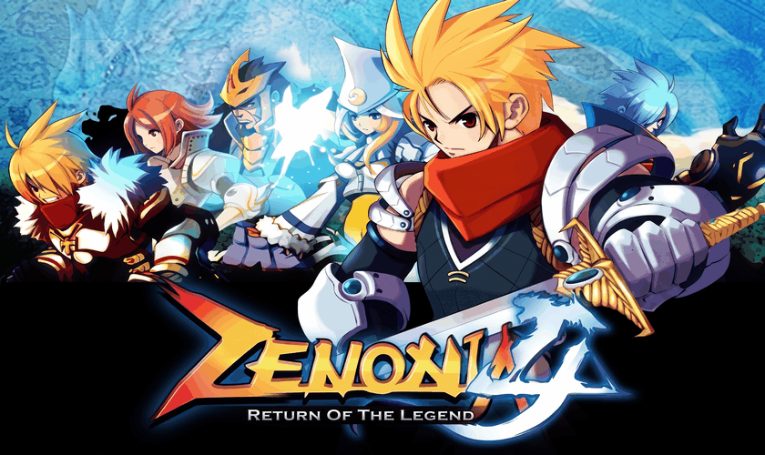

<h1 align="center">
Zenonia 4 · PS Vita Port (Turbo Edition)
</h1>
<p align="center">
  
</p>
<p align="center">
  <a href="#quick-overview">Overview</a> •
  <a href="#the-technical-reality--bottlenecks">Technical Deep-Dive</a> •
  <a href="#tested-build-variants--benchmarks">Tested Variants</a> •
  <a href="#known-issues--transparent-bug-tracker">Known Issues</a> •
  <a href="#controls">Controls</a> •
  <a href="#installation-guide-for-players">How to Install</a> •
  <a href="#building-from-source">Building</a> •
  <a href="#credits">Credits</a>
</p>

---

## Quick Overview

**ZENONIA® 4: Return of the Legend** is an action RPG developed and published by Gamevil. This repository contains an unofficial loader for the **ARMv7 Android release of Zenonia 4**, based on the Android SO Loader framework by TheFloW. The loader provides a tailored, minimalistic Android runtime environment (via FalsoJNI and VitaGL) to execute the original `libgameDSO.so` directly on the PlayStation Vita.

Unlike Zenonia 2 and 3 (which rendered at lower resolutions like 400×240 or 480×320), **Zenonia 4 runs internally in full 960×544 HD resolution**, quadrupling the pixel workload and software rasterization requirements on the Vita's hardware.

---

## 🔬 The Technical Reality & Bottlenecks

### 1. The CPU Software Rasterization Bottleneck
- **Engine Architecture**: Zenonia 4's engine (Gamevil Nexus2 / "Clet") is primarily a **CPU software rasterizer**. 
- **The Frame Loop**: On every frame, the ARM Cortex-A9 CPU executes hundreds of proprietary RLE sprite decompression calls (`PutCompressImg`), writing 16-bit RGB565 pixels directly into a 960×544 software framebuffer in RAM (~1,044,480 bytes).
- **The Memory Bus Limit**: Once software blitting finishes, the CPU uploads the entire 1.04 MB buffer to the GPU via `glTexSubImage2D` before calling `vglSwapBuffers()`.
- **The Performance Ceiling**: On the PS Vita's Cortex-A9 CPU running at 444 MHz, single-threaded software rasterization of 960×544 sprites maxes out at **~10–13 FPS** during combat.

---

### 2. The GPU Offload Dilemma (Why GPU Quads is NOT the Default)
During development (Fases 47–81, 108–113), an ambitious GPU Offload architecture (`GPU_QUADS` / `GPU_ATLAS`) was created to intercept `PutCompressImg` and offload sprite decoding into textured hardware quads via vitaGL. Extensive testing on physical Vita hardware revealed critical driver and architecture limitations:

| Problem Encountered | Technical Root Cause | Impact on Hardware |
| :--- | :--- | :--- |
| **💥 Hard Console Freezes / Bricks** | Dense combat scenes emit **12,000 to 16,000+ quads per frame**. Without VSync throttling, vitaGL's GPU ring buffer overflows. | **Requires 30s power button hard reset** (no `.psp2dmp` crash log generated). |
| **🌀 Stage Transition Desyncs** | Dynamic texture cache allocation during map/stage transitions caused vitaGL context stalls and black screens. | Game freezes when walking through transition portals. |
| **👻 Missing / Scrambled Sprites** | Color-key transparency (0x0001) and texture re-binding conflicts between the base framebuffer and atlas textures. | Sprites occasionally rendered with black rectangles or vanished entirely. |

> [!IMPORTANT]
> **Conclusion**: GPU sprite offload is inherently unstable for this engine on VitaGL. The safe, reliable path forward is **100% Authentic CPU Software Rasterization combined with Multi-Tier FrameSkip**.

---

### 3. The Solution: Multi-Tier FrameSkip & Turbo Architecture
To overcome the CPU bottleneck while preserving 100% original graphics and rock-solid stability:
1. **Intelligent Frame Pacing**: On skipped frames, `handleCletEvent` (touch/pad inputs), physics, enemy AI, damage calculations, and quest timers advance at full **60 Hz** in only **~1.5 ms**, while CPU RLE sprite blits and 1.04 MB texture uploads are bypassed.
2. **Real-Time Speed Multipliers**: Players can toggle between **1.0x (Normal)**, **1.5x**, **2.0x (Default)**, **2.5x**, and **3.0x (Max)** on the fly via `R-Trigger + SELECT`.
3. **FastClear Bypass**: Omits redundant full-frame 1.04 MB black clears on skipped frames, saving CPU memory bandwidth.
4. **Off-Screen UI Buffer Preservation**: Ensures all off-screen text caches (`p9 != 0`) are executed 100% of the time, fixing missing labels on inventory/pause popups (*Destroy*, *Repair*, *Equip*).
5. **No-Logs Turbo Release**: Completely compiles out debug logging (`ENABLE_LOGGING=OFF`), removing all SD card / SD2Vita write latency and format string overhead during gameplay.

---

## 📊 Tested Build Variants & Benchmarks

All optimization variants tested and documented in `port_progress.md`:

| Build Flag / Variant | Description | Observed FPS | Stability & Known Issues |
| :--- | :--- | :---: | :--- |
| **`--turbo-nologs`** *(Official)* | Multi-tier FrameSkip + FastClear Bypass + NEON Libc + Audio RAM cache + No Logs. | **20 – 30+ FPS** | **100% Stable**. Authentic graphics, zero crashes, zero stage-transition hangs. |
| **`--turbo-opt`** | Same as Turbo, but with active file logging to `ux0:data/zenonia-4/logs/`. | 18 – 25 FPS | Stable. Slight SD card I/O latency when logging frequent sound events. |
| **`--cpu-max-opt` / `--frameskip-test`** | Baseline FrameSkip on gameplay frames. | 15 – 22 FPS | Stable. Text in popups previously missing (fixed in Phase 123). |
| **`--skip-blit-test`** | Theoretical CPU FPS ceiling (PutCompressImg is a no-op; sprites not drawn). | ~24 – 28 FPS | Diagnostic only. Proves that CPU logic takes ~38 ms per frame without blits. |
| **`--fastclear-neon-test`** | Re-implemented `FastClearNonClipping` in ARM NEON. | ~11 – 13 FPS | Stable. Modest ~0.5 ms gain per frame. |
| **`--primitives-opt-test`** | NEON FastClear + NEON `memcpy`/`memset`. | ~12 – 14 FPS | Stable. Baseline memory copy optimization. |
| **`--downsample-test`** | Reduced internal rendering resolution (2/3 or 3/4) + GPU bilinear upscale. | ~18 – 22 FPS | **Flawed**. Alters the game's camera zoom/FOV because engine couples FOV with resolution. |
| **`--sprite-decode-test`** | Re-implemented RLE sprite decoding in portable C. | ~10 – 11 FPS | **Glitches**. Distorted sprites and broken alpha blending on complex equipment. |
| **`--sprite-decode-cache-test`** | CPU RAM cache for decoded sprite surfaces. | ~10 – 12 FPS | Ineffective. High cache miss rate during continuous combat animations. |
| **`--gpu-quads-test`** | Intercepts `PutCompressImg` and batches textured quads via vitaGL. | ~18 – 24 FPS | **Unstable**. Can crash in heavy combat and during stage transitions. |
| **`--gpu-quads-novsync-test`** | GPU Quads with VSync disabled (`DISABLE_VSYNC=ON`). | ~25 – 30 FPS | **DANGEROUS**. Overflows GPU command buffer; causes **hard system freeze** requiring hard reset. |

---

## 🐛 Known Issues & Transparent Bug Tracker

- **FPS in Extreme Combat Swarms**: In maps with 15+ simultaneous enemies, spell particles, and floating damage numbers, frame rate can temporarily dip below 20 FPS on 1.0x/1.5x modes. Using **2.0x or 2.5x** (cycled via `R-Trigger + SELECT`) is recommended.
- **Minimap Radar**: The minimap accurately displays character coordinates, quest markers, and enemy blips, but the terrain background texture of the radar is currently not rendered by the engine.
- **Virtual Touch Overlay**: The original Android virtual touch buttons are hidden by default (`HIDE_VIRTUAL_GAMEPAD`) to give a clean fullscreen view. Touch input remains fully functional on the front OLED screen.
- **Save Confirmation Header Alpha**: The header text on the save confirmation dialog inside the pause menu can occasionally render with high transparency depending on previous dialog state.

---

## 🎮 Controls

| Button / Input | In-Game Action |
| :--- | :--- |
| **D-Pad / Left Stick** | Move character / Navigate menus |
| **Cross (✕)** | Attack / Confirm / Interact |
| **Circle (◯)** | Back / Cancel / Menu |
| **Triangle (△)** | Skip dialogue / Cutscene |
| **Square (□)** | Open World Map |
| **L-Trigger** | Quick Save Game |
| **START + SELECT** | PS Vita options menu: button remapping, FPS, on-screen buttons (game pauses) |
| **R + SELECT** | Frame skip: **AUTO** (default) / OFF |
| **L + SELECT** | FPS: **23** (default, original game speed) / 30 (faster, Zenonia 2/3 style) |
| **R + L** | Show / hide the on-screen buttons (default: shown; hidden buttons still respond to touch) |
| **Front Touchscreen** | Full native touch controls & UI navigation |

Settings are saved to `ux0:data/zenonia-4/config.txt` and `controls.txt` (editable by hand). To quit, use the PS button.

---

## 📥 Installation Guide (For Players)

### Requirements
1. PS Vita / PS TV running firmware **3.60** or **3.65** with HENkaku / Enso.
2. [kubridge.skprx](https://github.com/bythos14/kubridge/releases/) installed in your `taiHEN` config under `*KERNEL`.
3. [fd_fix.skprx](https://github.com/TheOfficialFloW/FdFix/releases/) installed in your `taiHEN` config under `*KERNEL`.
4. `libshacccg.suprx` extracted to `ur0:data/` (obtainable via [ShaRKBR33D](https://github.com/Rinnegatamante/ShaRKBR33D)).
5. Legally obtained **Zenonia 4 Android APK** (v1.2.3 or similar ARMv7 build).

### Step-by-Step Installation
1. Install **`zenonia_4_turbo_nologs.vpk`** from [Releases](https://github.com/metalsyntax/zenonia4-vita/releases) using **VitaShell**.
2. Open your `.apk` file using an archive manager (like 7-Zip).
3. Extract the `assets/` folder and `lib/armeabi/libgameDSO.so` from the APK.
4. Copy them to your PS Vita so that the following structure exists:
   ```text
   ux0:data/zenonia-4/
   ├── libgameDSO.so
   └── assets/
       ├── com/
       ├── eng/
       ├── font/
       └── ...
   ```
5. Launch **Zenonia 4** from your LiveArea!

---

## 🛠️ Building from Source (For Developers)

### Prerequisites
- [VitaSDK](https://vitasdk.org/) properly installed and available in `$PATH`.
- Host system: macOS or Linux.

### Compile with the Automated Build Script
```bash
# Build the recommended Turbo No-Logs release:
./build.sh --turbo-nologs

# Build the Turbo release with debug telemetry:
./build.sh --turbo-opt

# Build standard release:
./build.sh
```

VPKs and binaries are exported directly to `build/`:
- `build/zenonia_4_turbo_nologs.vpk`
- `build/zenonia_4_turbo.vpk`
- `build/zenonia_4.vpk`

### Interactive Vita Deployment Tool
You can manage builds, deployments, and debug file sync with the bundled interactive helper:
```bash
python3 porting_tools/manage_vita.py
```

---

## 👥 Credits

- **Gamevil** for developing the legendary Zenonia series.
- **Andy "TheFloW" Nguyen** for the original Android `.so` loader framework.
- **Rinnegatamante** for [vitaGL](https://github.com/Rinnegatamante/vitaGL) and invaluable PS Vita graphics support.
- **Bythos** for [kubridge](https://github.com/bythos14/kubridge) and kernel enhancements.
- **MetalSyntax** for the Zenonia 4 PlayStation Vita port, Turbo optimization architecture, and FrameSkip implementation.

---

## 📄 License

This port loader is distributed under the terms of the **MIT License**. See the [LICENSE](LICENSE) file for details. Game assets and `libgameDSO.so` remain the proprietary intellectual property of Gamevil.
